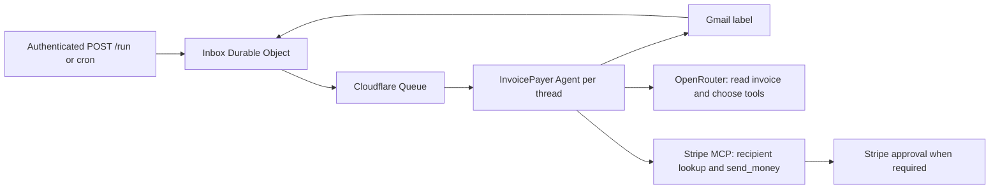

# Invoice Payer

A [Cloudflare Agent](https://developers.cloudflare.com/agents/) that reads invoices from Gmail and pays existing recipients with [Stripe Treasury](https://stripe.com/treasury), using [Stripe MCP](https://docs.stripe.com/mcp).

Apply a Gmail label to the threads you want processed, then trigger a run. The agent reads invoice PDFs (or plain text email when there is no PDF), looks up an existing recipient, and initiates payment. When Stripe requires approval, the agent follows the MCP response to supply a justification and reports the approval information in its summary. Human approval is handled in Stripe.

This is a headless, single-account sample. All requests share one Gmail mailbox and one Stripe account. Running it can initiate real payments according to the permissions and approval policies on your Stripe agent API key. Only label invoices you intend it to pay.

## Requirements

- Node.js 24 and pnpm 10.
- An [OpenRouter API key](https://openrouter.ai/settings/keys) with access to the configured model. The default is `anthropic/claude-sonnet-5`; set `OPENROUTER_MODEL` in `wrangler.jsonc` to another model that supports tool calling and native PDF input if needed. The sample explicitly selects OpenRouter's native PDF engine so the model receives the document directly.
- A Stripe account with Treasury and its MCP tools enabled, existing recipients, and an [agent API key](https://docs.stripe.com/keys#agent-keys) permitted to look up recipients and send money. Treasury MCP tools are in public preview and availability depends on the account. The workflow uses Stripe's lookup tools, `send_money`, and `stripe_api_write` for approval justifications when requested.
- Google OAuth credentials for a Gmail account, with the `https://www.googleapis.com/auth/gmail.readonly` scope.
- A Cloudflare account with Workers, SQLite-backed Durable Objects, and Queues for deployment. Local development uses emulated Cloudflare services but real Gmail, OpenRouter, and Stripe APIs.

## Install

```bash
cd invoice-payer
pnpm install
cp .dev.vars.example .dev.vars
```

Fill in `.dev.vars` with your Stripe and OpenRouter keys, Google OAuth credentials, and a random `RUN_AUTH_TOKEN` of at least 32 characters. Generate the token with `openssl rand -hex 32`. This file is ignored by Git. Use an agent API key for Stripe; full-access secret keys and older restricted keys are being retired for MCP access.

### Connect Gmail

1. Create a Google Cloud project and [enable the Gmail API](https://developers.google.com/workspace/gmail/api/quickstart/js#enable_the_api).
2. Configure the OAuth consent screen. If the app is in testing, add your Gmail address as a test user.
3. Create an OAuth client of type **Web application**. For initial setup using Google's [OAuth Playground](https://developers.google.com/oauthplayground/), add `https://developers.google.com/oauthplayground` as an authorized redirect URI.
4. In the playground's settings, select **Use your own OAuth credentials** and enter the client ID and secret. Request `https://www.googleapis.com/auth/gmail.readonly` with offline access, authorize your mailbox, and exchange the authorization code for a refresh token.
5. Put the client ID, client secret, and refresh token in `.dev.vars` as `GOOGLE_CLIENT_ID`, `GOOGLE_CLIENT_SECRET`, and `GOOGLE_REFRESH_TOKEN`. OAuth apps in testing can have short-lived refresh tokens; configure the consent screen appropriately for continued use.
6. Create the Gmail label `invoices`, or change `GMAIL_LABEL` in `wrangler.jsonc` to the exact name of your label. Use a dedicated label: the first run includes existing labeled mail, not just newly received messages.

The sample only reads Gmail; it does not send email, change labels, or mark mail as read.

## Run locally

```bash
pnpm dev
```

In another terminal, set `RUN_AUTH_TOKEN` to the same token you placed in `.dev.vars`, then trigger a poll:

```bash
export RUN_AUTH_TOKEN='your-random-token'
curl -X POST http://localhost:8787/run \
  -H "Authorization: Bearer $RUN_AUTH_TOKEN"
```

The response is `202` with the thread IDs queued for processing. The Queue consumer runs asynchronously. Inspect recent threads and an individual run:

```bash
curl http://localhost:8787/threads \
  -H "Authorization: Bearer $RUN_AUTH_TOKEN"

curl http://localhost:8787/threads/THREAD_ID \
  -H "Authorization: Bearer $RUN_AUTH_TOKEN"
```

Each poll scans up to 100 labeled messages and retains Gmail's pagination cursor for the next poll. Continue polling to traverse the label. After the last page, the next poll starts from the newest messages again. `/threads` lists the 100 most recently updated records.

### Reset local Cloudflare state

Stop `pnpm dev`, then run:

```bash
pnpm reset:local
```

This removes Wrangler's local emulation state, including Durable Object SQLite data and queued messages. Start `pnpm dev` again afterwards. It does not change deployed Cloudflare resources or Stripe data, but it also removes the local durable guards that prevent a Gmail thread from being processed again. Use a dedicated development Gmail label and Stripe test environment, and do not reset while a run could have initiated an external payment.

| Status | Meaning |
| --- | --- |
| `queued` | Discovered; waiting for Queue delivery. |
| `pending` | Agent created; processing has not started. |
| `processing` | Run started; it will not be started again. |
| `completed` | The agent finished its review. Read the summary: payments may be skipped, unsuccessful, or awaiting Stripe approval. This does **not** mean all invoices are paid. |
| `needs_review` | The run failed or the model stopped at a limit instead of completing its response. Review the outcome manually. |

If a run remains `processing` after a Worker interruption, inspect its payments and approvals in Stripe. The sample deliberately has no reset/replay endpoint. Reconcile and finish unresolved payments in Stripe rather than replaying the thread. Approval flows that need another interactive tool call must also be completed outside this unattended run.

## Deploy

Create the queue once and store each credential as a Worker secret:

```bash
pnpm exec wrangler login
pnpm exec wrangler queues create invoice-payer

pnpm exec wrangler secret put STRIPE_API_KEY
pnpm exec wrangler secret put OPENROUTER_API_KEY
pnpm exec wrangler secret put GOOGLE_CLIENT_ID
pnpm exec wrangler secret put GOOGLE_CLIENT_SECRET
pnpm exec wrangler secret put GOOGLE_REFRESH_TOKEN
pnpm exec wrangler secret put RUN_AUTH_TOKEN

pnpm deploy
```

Use the deployed Worker URL in the same authenticated requests. For automatic polling, set `triggers.crons` in `wrangler.jsonc` to `["*/5 * * * *"]` and redeploy. Polling is disabled by default. Removing the cron stops discovery; already queued threads may still run.

Keep the Worker, queue, Durable Object bindings, and stored data together when updating the deployment. Changing the Worker identity, clearing `.wrangler/state`, or deleting Durable Object data removes the records that prevent replay. Use a separate Gmail label and Stripe environment for development and deployment; their ledgers are independent.

## How it works



- `src/index.ts` authenticates every HTTP route and dispatches queue messages. Framework RPC and WebSocket routes are not exposed.
- `src/inbox.ts` records discovered threads and pagination in SQLite before sending queue messages. Entries remain in the outbox until the consumer reports an Agent's state, so a failed enqueue can be delivered again.
- `src/agent.ts` uses one named `Agent` per thread. It persists `processing` before external calls. Duplicate deliveries and restarts return the stored state instead of rerunning a payment flow. MCP connects only during a run and is removed afterward. All tools discovered from Stripe MCP are passed directly to the model through `this.mcp.getAITools()`, alongside the Gmail tools. The agent uses Stripe's tool schemas and responses to handle payments and approval justifications.
- `src/gmail.ts` validates API responses, scopes attachments to the selected thread, and checks PDF sizes and signatures. HTML-only email is skipped; messages with PDFs never fall back to email text. Limits are 50 messages, 100,000 characters of thread text/metadata, and 10 MiB per PDF.
- `src/prompt.ts` describes invoice extraction, PDF precedence, exact recipient matching, and Stripe approval handling. These semantic decisions are made by the model; use Stripe permissions and approval policies to enforce your financial controls.

Thread deduplication is not invoice-level idempotency: the same invoice sent in two different threads can be processed twice. The agent also reasons about repeated invoices within a thread, but this is not a deterministic accounting control. This sample processes a thread once; later replies in that thread are not processed. For broader automation, add invoice-level reconciliation and business-specific payment policies.

Invoice content is sent through OpenRouter to the selected model provider. Summaries may contain financial information and approval links; they are stored in Durable Object state and returned only through authenticated routes. Application logs contain thread IDs and error types, not raw invoice text, tool inputs, or credentials. Use [Stripe Workbench](https://docs.stripe.com/workbench/overview#mcp-tool-call-logs) to inspect Stripe MCP activity.

## Development

```bash
pnpm lint
pnpm typecheck
pnpm test
pnpm build
```

`typecheck` generates runtime and binding types from Wrangler before checking strict TypeScript. `build` bundles the Worker without deploying. Tests run inside the Workers runtime with mocked external requests and cover Gmail parsing, attachment isolation, direct MCP tool use and approval responses, authentication, and durable replay protection. They do not make payments or require real credentials. Run `pnpm format` to apply Biome formatting and safe lint fixes.

Based on [Suresh's original Stripe agent demo](https://github.com/sureshs592/stripe-agent-demo).
